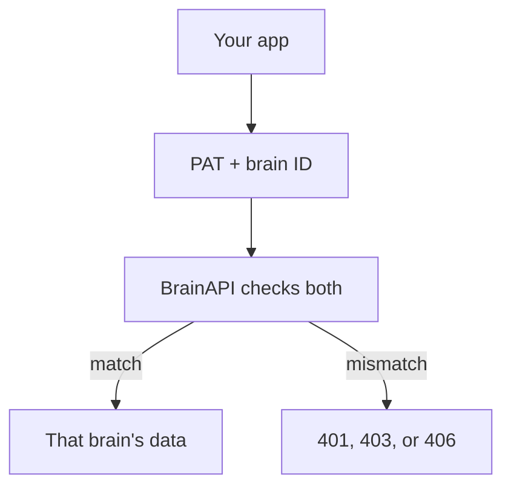

A **brain** is a named, locked room for knowledge. Everything you save or ask is scoped to one brain. Two brains never share facts, passages, or tasks. You prove who you are with a personal access token (PAT), and you name the room with a brain ID. BrainAPI checks both before it reads or writes.

## Why it exists

Products that remember people mix tenants by accident: a support bot quotes another company's ticket, or a user sees someone else's notes. Isolation is the first feature, not an add-on.

Everyday example: a clinic app gives each practice its own brain. The front desk at Riverside Pediatrics can ask "What is Maya's last visit?" and only Riverside's notes are searched. Oak Street Family Medicine uses a different brain ID and a different brain-scoped token. There is no shared pile of patients.

## When to use it

**Use a brain when** you have a natural boundary: one customer, one team, one product line, or one user. Give each boundary its own brain ID and, in production, its own brain-scoped PAT.

**Do not** put unrelated tenants in one brain and filter later in your app. BrainAPI isolation is the brain itself. **Do not** send the system-wide token to browsers, assistants, or customer integrations. **Do not** invent a brain ID with spaces or hyphens; IDs are letters and digits only (`supportkb` is valid, `Support KB` and `support-kb` are not). The reserved name `system` is not an application brain.

## How it works

1. Your app sends a PAT (`BrainPAT` header, or `Authorization: Bearer …`) and a brain ID (`X-Brain-ID` is the preferred place).
2. BrainAPI decides which brain the request means: header, then query, then JSON body for `POST`, `PUT`, or `PATCH`, then a multipart field for file uploads.
3. If the token is a **brain PAT**, it may only touch that one stored brain. If it is the **system PAT**, it may administer brains and call `/system/*`.
4. On success, every ingest, retrieve, task, and graph call stays inside that room.

`X-Brain-ID` is the alphanumeric Brain ID from dashboard Settings (`name_key`), not the display name you might show in a UI.

## Going deeper

### System PAT versus brain PAT

**What.** The system token can create, list, clear, and delete brains. A brain PAT is issued when that brain is created and is limited to it.

**Why.** Operators need a master key. Applications should not have one.

**When.** Keep the system PAT in your control plane. Hand each app or assistant a brain PAT. v2.21.1 has no rotate-PAT route; treat a leak as "replace the brain's credentials by operator process," not as a self-serve rotate call.

### How a brain is selected

**What.** BrainAPI looks at `X-Brain-ID`, then `brain_id` on the query string, then a top-level JSON `brain_id` for `POST`, `PUT`, or `PATCH`, then a multipart `brain_id`.

**Why.** Different clients (JSON, file upload, GET) need one rule.

**When.** New integrations should always send `X-Brain-ID` so routing does not depend on body shape.

### Automatic creation and fallback

**What.** `BRAIN_CREATION_ALLOWED=true` can create a missing named brain. `DEFAULT_BRAIN_FALLBACK=true` can select or create `default` when no brain is sent. Both are **off** in runtime when unset (example env files often turn them on for local setup).

**Why.** Local demos should start without a ceremony. Production should not hide typos.

**When.** Leave both off in production. Create brains with `POST /system/brains` and pass the ID on every request.

### Token scopes

**What.** Default PAT scopes are `brainapi`. Writes that verify or reject facts also need `verification`, which is **not** granted by default. Resolved scopes are cached for 30 seconds.

**Why.** Marking a fact trusted is a stronger power than reading memory.

**When.** Grant `verification` only to review tools and operators. See [Verified and rejected facts](/v2/concepts/verification).

### Clear or delete a brain

**What.** `POST /system/brains/{brain_id}/clear` empties the room and keeps the ID and PAT. `DELETE /system/brains/{brain_id}` removes the room, PAT, and cached credentials.

**Why.** You sometimes need a reset without minting a new identity, and sometimes a true teardown.

**When.** Use the system PAT. Stop active imports first. A **409** means another lifecycle job is running; a **503** `BRAIN_CLEANUP_FAILED` means a backend did not finish cleanup.

### Login info

**What.** `GET /meta/login-info` does not require a brain. It tells a console whether the PAT is system-wide or tied to one brain.

**Why.** The web console needs to know whether to show a brain switcher.

**When.** Use it at login, not as a substitute for sending `X-Brain-ID` on data requests.

## Technical reference

- [Authentication and brains](/v2/brains-and-auth)
- [Configuration](/v2/configuration)
- [Errors and HTTP statuses](/v2/reference/errors)
- [System API](/v2/reference/api/system)
- [Metadata API](/v2/reference/api/meta)
- [Glossary: brain](/v2/reference/glossary)
