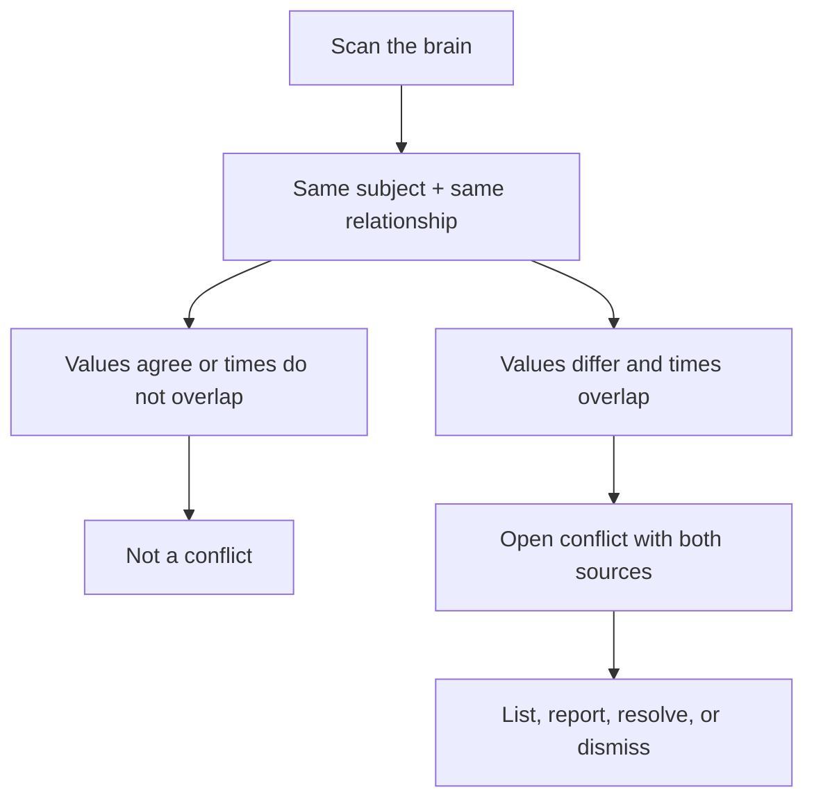

A **conflict** is two facts that talk about the same subject and relationship, disagree on the value, amount, or polarity, and overlap in time. **Provenance** is the trail back to the sources of those facts — which document, which passage, which import. Same-source revisions (an old copy versus the new copy of one file) are **not** conflicts; those are [source revisions](/v2/concepts/sources).

## Why it exists

Organizations collect overlapping notes. HR says Maya reports to Alex; an org chart dump says she reports to Sam, and both are dated this quarter. If you only keep the latest write, you hide the disagreement. If you keep both with no flag, an assistant may pick at random.

Everyday example: a handbook PDF says the store closes at 8 pm. A manager's email from the same week says 9 pm. A conflict scan lists both, with pointers to the PDF passage and the email. A person chooses, or leaves it open until someone checks.

## When to use it

**Use conflict scan** when several sources feed one brain and contradictions would hurt answers. **Use provenance fields on context** whenever a user might ask "where did that come from?"

**Do not** expect ingest to scan automatically; `CONFLICT_DETECT_ON_INGEST` is **false** by default. **Do not** treat two versions of the same source as a conflict. **Do not** assume leftover-pair judging is on (`CONFLICT_DETECT_LLM` defaults to **false**). On-demand scan is available on a 2.21.0+ engine; older public hosts return **404** for `/retrieve/conflicts`.

## How it works

1. You `POST /retrieve/conflicts/scan` (REST only; there is no MCP scan tool). The body may set `use_llm` only. You get **202** and a `task_id`.
2. The scanner groups facts by subject and relationship, up to `CONFLICT_DETECT_MAX_RELATIONSHIPS` (default 10000; `0` means unlimited). Capped scans page through the brain and continue later from a saved cursor.
3. Open conflicts can be listed, exported as a report, resolved (pick a winner), or dismissed (close without a winner).
4. A later scan can mark a conflict **stale** if the contradiction no longer holds (a side was removed or superseded, windows no longer overlap, values now agree, or an explicit leftover-pair verdict says they do not contradict). The same contradiction can reopen if it appears again.

Context retrieval can also carry provenance on each triple (`source_chunk_ids`, `source_session_ids`) and `source_passages` so an answer can cite the original wording even when there is no conflict.

## Going deeper

### On-demand scan

**What.** `POST /retrieve/conflicts/scan` queues a job. Counts such as `truncated` and `scanned_relationships` land on the **task** result, not the 202 body. REST cannot override the relationship cap.

**Why.** Scanning a large brain is work, not a quick GET.

**When.** Run it after big imports or on a schedule. Poll the task in the same brain.

### Ingest-time detection (opt-in)

**What.** `CONFLICT_DETECT_ON_INGEST=true` scans subjects touched by that import.

**Why.** Some teams want a flag as soon as a contradiction is written.

**When.** Leave off until you have someone to review the queue. Incremental ingest scans can page past the default cap; full on-demand scans honor the env cap.

### Resolve and dismiss

**What.** `manual` records a winner without rewriting verification. `verified_side` verifies the winner and rejects the other side (needs the `verification` scope). `dismiss` closes with no winner. `stale` is scanner-only.

**Why.** Not every disagreement deserves a hidden fact; sometimes you only need a note.

**When.** Use `verified_side` when a reviewer is sure one side should disappear from ordinary retrieve. If reject fails, BrainAPI restores the previous verification properties, tags a history entry `rollback`, and keeps the conflict open.

### Reports

**What.** `GET /retrieve/conflicts/report` (`format=json` or `markdown`). MCP `conflict_report` is similar, with a smaller page size.

**Why.** Reviewers want a packet, not a raw list.

**When.** Use markdown for a human queue; JSON for a tool.

### Provenance without a conflict

**What.** Context triples can include source chunk and session ids. Graph walks and MCP `get_conflict` show both sides of a flagged pair.

**Why.** "Where did this come from?" is useful even when sources agree.

**When.** Always prefer returning citations in user-facing answers. Do not strip passage ids in your app if you need an audit trail.

## Technical reference

- [Conflicts](/v2/retrieval/conflicts)
- [Fact verification](/v2/retrieval/verification)
- [Context](/v2/retrieval/context)
- [Ingestion tasks](/v2/ingestion/tasks)
- [Retrieve API](/v2/reference/api/retrieve)
- [What's new](/v2/changelog)
