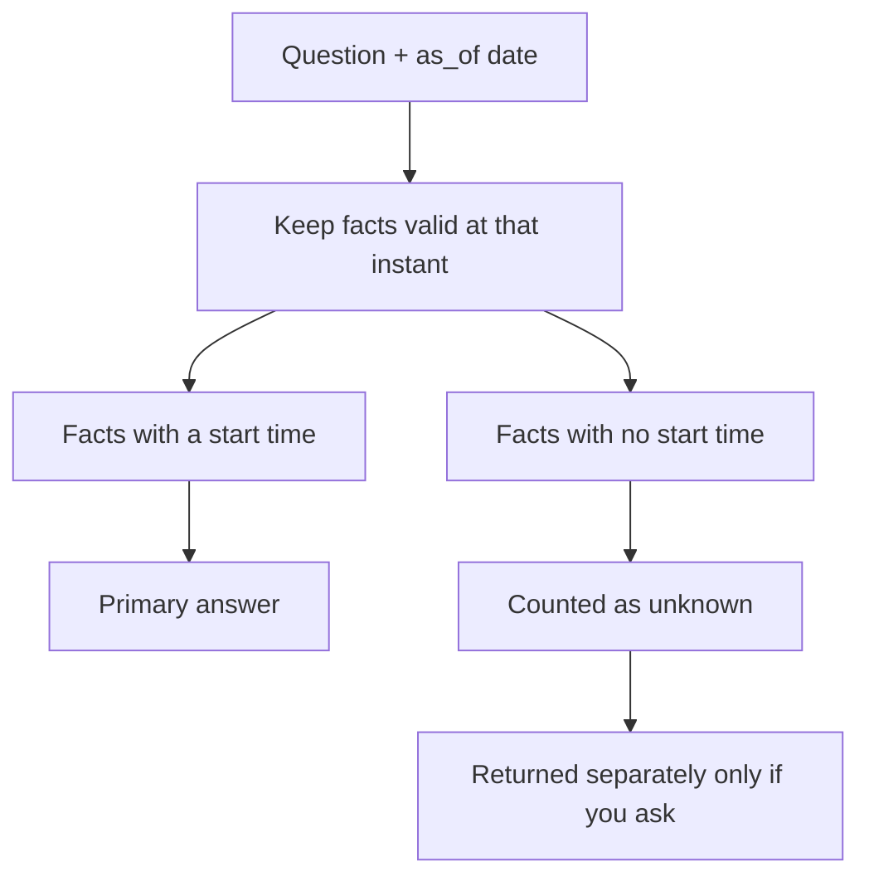

**History** means BrainAPI can keep both the current fact and what used to be true. **As-of** (sometimes called time-travel) means you ask a question as if today were a past date. Facts can carry a validity window (`valid_from` / `valid_to`). When a fact is replaced, the old one can be marked superseded instead of erased.

## Why it exists

Policies, assignments, and prices change. If you only store the latest sentence, you cannot answer "What was the on-call policy last March?" and you cannot explain how a fact evolved.

Everyday example: in January the handbook said "Support replies within two days." In April it changed to one day. A customer asks in June, "What did you promise in March?" An as-of query for 1 March should still see the two-day rule. Today's query should see one day. Both sentences remain on file.

## When to use it

**Use as-of** when the question names a time, or when a reviewer needs the facts that were valid at an instant. **Use changelogs** when you want a list of what was added, superseded, or invalidated in a window. **Use history-aware context** when the user is asking about a prior version of a document.

**Do not** pass `as_of` for ordinary current-state questions. **Do not** assume undated facts will be included; as-of **fails closed** and omits them unless you opt in. **Do not** use compact timestamps such as `2024-01-01T930` — prefer a full ISO-8601 datetime with an offset.

## How it works

1. Each fact may have a valid-time start and end.
2. When `as_of` is set, BrainAPI keeps facts whose window includes that instant.
3. Facts with no start time are **omitted** from the main result and counted in `validity_unknown_count`.
4. `include_validity_unknown=true` returns those undated facts in a separate `validity_unknown` list. They still do not join the primary result.
5. Changelogs list created, superseded, and invalidated relationships in a `since`–`until` window (`since` inclusive, `until` exclusive).

MCP as-of is available on `search_semantically` only. `search_memory` and `traverse_graph` do not take `as_of`.

## Going deeper

### As-of on context and search

**What.** `POST /retrieve/context`, `GET /retrieve/`, and `GET`/`POST /retrieve/search` accept `as_of` and `include_validity_unknown`.

**Why.** One switch should apply to the surfaces people already use.

**When.** Pass a full ISO-8601 instant. Invalid values fail the request. See [known parsing caveats](/v2/changelog#known-issues).

### Validity windows

**What.** Graph relationships can store when they started and stopped being true. Superseded facts remain; they are not the current copy.

**Why.** Append-only history is how you reconstruct the past.

**When.** Prefer dated events at ingest time so as-of has something to filter. Undated imports will disappear from as-of results.

### Changelogs

**What.** `GET /retrieve/changelogs`, `GET /retrieve/changelogs/{id}`, `GET /retrieve/changelogs/types`. MCP: `list_changelogs`, `get_changelog`. Types include `relationship_created`, `relationship_deprecated`, `node_properties_updated`, and `relationship_properties_updated`.

**Why.** Auditors ask "what changed this week?" not "answer this sentence."

**When.** Use `since` and `until` together for a window. MCP `list_changelogs` also accepts `query_text` and `types`.

### History-aware context

**What.** `POST /retrieve/context` accepts optional `include_history`. `true` returns prior copies (superseded source text is labeled `[superseded]`). `false` returns only the current copy. If you omit the field, BrainAPI compares the question to example "prior version" versus "current value" questions (in several languages) and includes history only when the question is closer to the prior-version examples. If embedding is unavailable, it stays on the current copy.

**Why.** "What did the policy used to say?" and "What does the policy say now?" should not need two APIs.

**When.** Set the flag explicitly when your product knows which the user means. Leave it omitted only when automatic detection is acceptable.

### MCP traverse and invalidated hops

**What.** `traverse_graph` returns the walk and also lists superseded relationships in `invalidated` when a relationship has `invalid_at` or `deprecated`.

**Why.** A path that used to exist still matters for investigations.

**When.** Use traverse when you already know a start node. Use `search_semantically` with `as_of` for time-scoped semantic questions.

## Technical reference

- [As-of retrieve](/v2/retrieval/as-of)
- [Context](/v2/retrieval/context)
- [Retrieve API](/v2/reference/api/retrieve)
- [Product MCP](/v2/agentic/MCP)
- [What's new](/v2/changelog)
