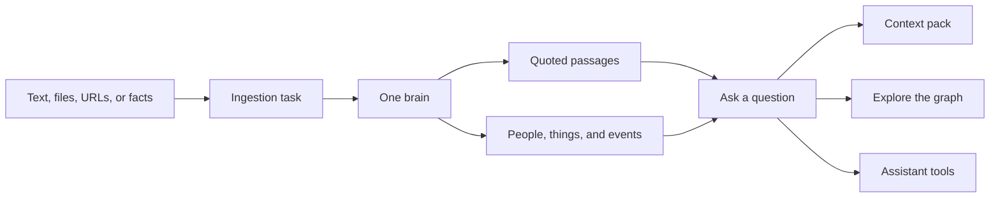

BrainAPI is a place to store what your product knows, keep that knowledge in separate rooms called **brains**, and later ask questions with a trail back to the original notes. You send text, files, or already-shaped facts. BrainAPI turns them into passages you can quote and a knowledge graph of people, things, events, and relationships. Assistants, search screens, and operators then read from the same brain.

This Concepts section explains each major feature in everyday language. The [Build](/v2/quickstart), [Retrieve](/v2/retrieval), and [Reference](/v2/reference) sections remain the technical how-to and API contract. Behavior here matches BrainAPI **2.21.1**.

<Callout type="info" title="Who these pages are for">
Read this section if you are choosing BrainAPI for an application, connecting an assistant, or explaining the product to a teammate. You do not need a background in memory research, graphs, or retrieval systems.
</Callout>

## The product in one picture

1. Pick a **brain** so one team's knowledge never mixes with another's.
2. **Ingest** material. Work runs in the background; you poll a task until it finishes.
3. **Retrieve** what you need: a context pack for an assistant, a graph walk, a historical snapshot, or a conflict report.
4. When two sources disagree, or a fact should be trusted or ignored, use **conflicts** and **verification**.

## Feature map

| Feature | In one sentence | Start here |
| --- | --- | --- |
| [Brains and isolation](/v2/concepts/brains) | Each brain is a locked room; a token and a brain ID must both match. | Tenant or user memory |
| [Ingestion](/v2/concepts/ingestion) | Send text, files (with optional OCR), URLs, or structured facts; spreadsheets are an opt-in experiment. | Getting knowledge in |
| [Knowledge graph](/v2/concepts/knowledge-graph) | BrainAPI finds the people, things, and events in that material and connects them. | "Who did what, when?" |
| [Retrieval, chat, and Explore](/v2/concepts/retrieval) | Ask a question, browse the graph, or (optionally) chat against the brain. | Answering from memory |
| [History and as-of queries](/v2/concepts/history) | Ask what was true on a given date; superseded facts stay on file. | Facts that change |
| [Conflicts and provenance](/v2/concepts/conflicts) | Two sources that disagree are flagged, with a path back to each source. | "Where did this come from?" |
| [Verified and rejected facts](/v2/concepts/verification) | An expert can mark a fact trusted or hidden from ordinary answers. | Human review |
| [Source revisions and dedupe](/v2/concepts/sources) | Re-importing a document keeps older copies; similar entities are merged when possible. | Living documents |
| [Tasks, cancel, and rollback](/v2/concepts/tasks) | Every import is a job you can watch, stop, or undo. | Long imports |
| [MCP and OAuth](/v2/concepts/mcp) | Assistants call BrainAPI tools without you pasting REST details into a prompt. | Agent memory |
| [SDKs, PATs, and billing](/v2/concepts/sdks-and-billing) | Tokens, client libraries, and managed plan prices. | Getting access |

## Which features for which goal

| If you need… | Use | Usually skip |
| --- | --- | --- |
| My assistant should remember users or a knowledge base | A brain per tenant or user, [text or file ingestion](/v2/concepts/ingestion), then [context retrieval](/v2/concepts/retrieval) | Ranked Search unless your UI is a search box; Search is **off** on hosted production |
| My assistant should remember users **and** call tools itself | The same path, plus [MCP](/v2/concepts/mcp) | Putting a system-wide token inside the assistant |
| My facts change over time | [History and as-of](/v2/concepts/history) and [source revisions](/v2/concepts/sources) | Treating every import as a wipe-and-replace |
| I need to know where an answer came from | Context packs (passages and graph paths), then [conflicts and provenance](/v2/concepts/conflicts) | Trusting a score with no source list |
| Two documents contradict each other | [Conflict scan](/v2/concepts/conflicts) and, if a person should decide, [verification](/v2/concepts/verification) | Auto-detect on every ingest (that flag is **off** by default) |
| I uploaded a scanned PDF | [File ingestion and OCR](/v2/concepts/ingestion) | Spreadsheet import; scans are not workbooks |
| I have a spreadsheet of rows to query as a table | Spreadsheet import, **experimental and opt-in** | The knowledge-graph pipeline; gated brains skip that path for `.xlsx` / `.csv` |
| I need to browse a large graph | [Explore](/v2/concepts/retrieval) on the PostgreSQL graph driver | Explore on other graph stores (they return **501**) |
| I already have a database of rows and foreign keys | Ordinary application storage | BrainAPI, unless language or changing events is the real problem |

## What stays optional

BrainAPI ships with safe defaults. Turn a capability on only when you need it:

| Capability | Default | Notes |
| --- | --- | --- |
| Ranked Search | Off (`SEARCH_ENABLED=false`) | Hosted production returns **404** for `/retrieve/search`. Use context retrieval instead. |
| Spreadsheet import | Off (`SPREADSHEET_EXPERIMENT_BRAINS` empty) | **Experimental.** PostgreSQL brains only. Added in 2.21.1. |
| Conflict scan on ingest | Off | On-demand scan is always available on a 2.21.0+ engine. |
| Extra leftover-pair judging | Off | Optional; leave it off unless you have a review workflow. |
| Fact verification writes | Off (no `verification` scope) | Any valid token can *read* states. |
| Staged ingest cancel / rollback | Off | Enable staging only when you need stop-and-undo during a run. |
| Explore | PostgreSQL graph driver only | Other drivers return **501**. |
| Chat against the brain | Optional plugin | Not part of the core API. |
| Hosted MCP sign-in | Off until OAuth issuer URLs are set | 2.21.1 encrypts stored access keys for that flow. |

Python and Node client libraries exist but are **pre-1.0**. For production traffic, prefer REST until those packages reach 1.0. See [SDKs, PATs, and billing](/v2/concepts/sdks-and-billing).

## What these pages are not

- They are not a claim that BrainAPI replaces a search engine, a warehouse, or a row store.
- They do not compare BrainAPI with other retrieval designs.
- They describe shipped 2.21.1 behavior. Public regional hosts can lag; a **404** on a new route often means that host has not rolled the matching engine yet. See [Regional API hosts](/v2/reference/regional-hosts).

## Next step

If you are implementing, follow the [Quickstart](/v2/quickstart), then [Authentication and brains](/v2/brains-and-auth). If you are choosing features, pick the row in the table above and open that Concepts page.
