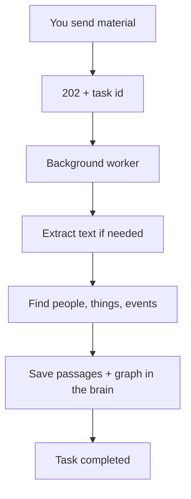

**Ingestion** is how knowledge gets into a brain. You send text, a file, a public URL, or facts you already know. Most ingest routes accept the work with HTTP **202** and a `task_id`, then process it in the background. When that task completes, passages and graph facts in that brain become available to retrieve. The spreadsheet experiment is the exception: it finishes in the request.

## Why it exists

Source material almost never arrives as a finished database. People paste chat logs, upload PDFs, point at a help center, or already know "Maya prefers morning appointments." Ingestion is the loading dock: one place to accept those shapes and turn them into memory without your app running its own extraction pipeline.

Everyday example: a facilities team drops last month's incident PDF into the brain and also types "Elevator B is out of service until Friday." Later, an assistant can answer "Which elevators are down?" from both the report and the note.

## When to use it

**Use ingestion when** the knowledge lives in language, documents, pages, or events you want remembered. For asynchronous routes, poll the task before you query; a 202 only means "accepted," not "ready."

**Do not** ingest if a normal table already answers the question. **Do not** treat a 202 as success of the import. **Do not** send secrets, credentials, or private screenshots. **Do not** assume Search indexes exist unless Search is enabled on that deployment.

## How it works

1. You POST to an ingest route with a PAT and brain ID.
2. Text, file, URL, and structured routes queue a task and return `task_id`. Direct spreadsheet upload does not.
3. A worker extracts text (from a file or page if needed), optionally builds graph facts, and stores passages.
4. For those asynchronous routes, poll `GET /tasks/{task_id}` in the **same** brain until a terminal status. A **404** means the task is unknown, not "still running."

## Going deeper

### Plain text

**What.** `POST /ingest/` with `{ "data": { "data_type": "text", "text_data": "…" } }`. You may send a `Task-Identifier` header to choose the task id.

**Why.** Notes, tickets, chat turns, and already-extracted Markdown are already language.

**When.** This is the default path. Set `skip_enrichment=true` when you only need passages (for example a search corpus) and do not want graph extraction.

### Files and OCR

**What.** `POST /ingest/file` as multipart, one file per request. Accepted types include PDF, DOC/DOCX, XLS/XLSX, TXT, CSV, JSON, JPG, and PNG. The worker extracts text; scanned pages go through OCR. `OCR_MODE` selects the extractor (`docling` is the runtime default; example env files often set `docparser`).

**Why.** Teams store knowledge in documents and images, not only in APIs.

**When.** Use files when you do not want to parse PDFs yourself. Check OCR mode and worker logs if a file task is accepted but never progresses. Spreadsheet-shaped `.xlsx` / `.csv` files take a different path when the spreadsheet experiment is on for that brain (see below).

### Public URLs

**What.** `POST /ingest/url` with an `https` URL. BrainAPI crawls through the configured crawler, waits for cleaned page JSON (title, headings, core content, facts), and ingests that — not raw page Markdown.

**Why.** Help centers and public docs change; you want the cleaned article, not the chrome.

**When.** Public pages only. Hosted progressive URL imports can report per-page activity on the root task. See [Save URLs](/v2/ingestion/urls).

### Structured facts

**What.** `POST /ingest/structured` sends facts you already know: a person, a relationship, an object, optionally an event with a time. Modes are `deterministic` (write as given), `hybrid` (keep yours, fill gaps), and `enrich` (add semantic detail). If you omit `mode`, BrainAPI picks `hybrid` when `text` is present and `deterministic` otherwise.

**Why.** Checkout events and catalog attributes should not be guessed from a paragraph.

**When.** Use direct `subject → predicate → object` edges for stable facts such as "has" or "prefers." Use an event hub when the action's time or context matters. Sending only one of `event` / `event_obj` is invalid.

### Spreadsheets (experimental, opt-in)

**What.** In 2.21.1, `.xlsx` and `.csv` can import as workbooks instead of the text pipeline. Gate: `SPREADSHEET_EXPERIMENT_BRAINS` (comma-separated brain IDs, or `*` for all). Empty or unset disables every brain. Direct upload `POST /ingest/spreadsheets` completes in the request and returns **201** with workbook metadata — no `task_id`. List/query: `GET /retrieve/spreadsheets`, `POST /retrieve/spreadsheets/query`. **PostgreSQL brains only.** Disabled brains fall through to normal file ingest; retrieve routes return **404**.

**Why.** Some knowledge is a table you want to filter, not a story you want to graph.

**When.** Turn it on only for brains that should query sheets as rows. Do not use it for scans, PDFs, or mixed documents. Treat it as an experiment: the contract can still change.

### Interview

**What.** A guided capture flow that turns a conversation with a person into ingestible notes. See [Interview someone](/v2/ingestion/interview).

**Why.** Expertise often lives in someone's head, not in a file.

**When.** Use it for onboarding an expert. Use ordinary text ingest when you already have the transcript.

### Skipping enrichment

**What.** `skip_enrichment=true` stores chunks and embeddings without running the graph extraction swarm.

**Why.** Not every corpus needs people-and-events structure.

**When.** Search-only collections, or when supplied structured facts must stay literal (`deterministic` mode is the structured equivalent).

## Technical reference

- [Ingestion overview](/v2/ingestion)
- [Save text](/v2/ingestion/text)
- [Save files](/v2/ingestion/files)
- [Save URLs](/v2/ingestion/urls)
- [Save structured data](/v2/ingestion/structured-data)
- [Track ingestion tasks](/v2/ingestion/tasks)
- [Ingest API](/v2/reference/api/ingest)
- [Configuration](/v2/configuration)
