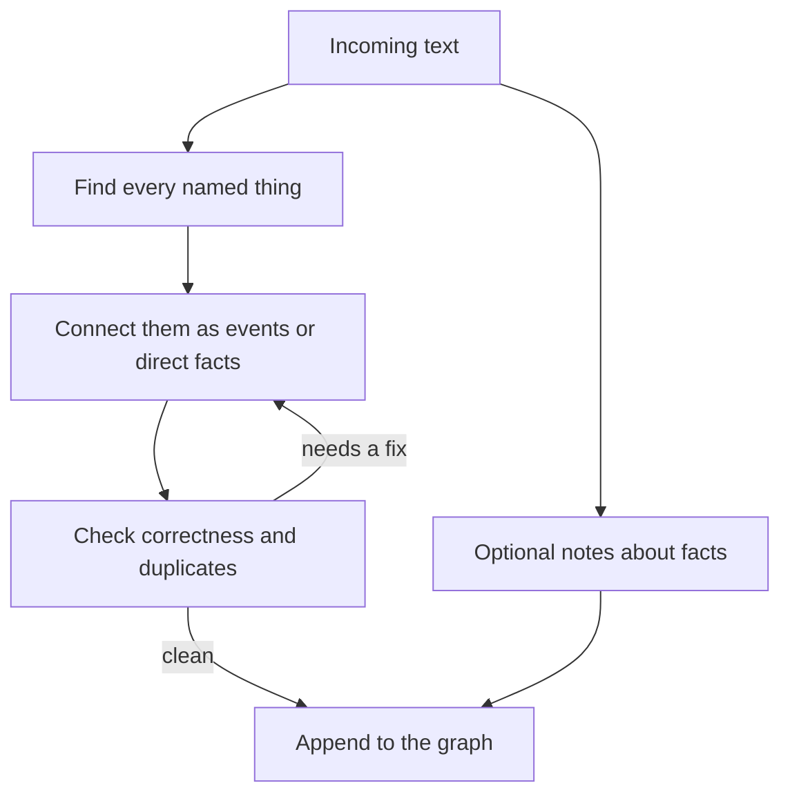

The **knowledge graph** is BrainAPI's map of what a brain knows: named people and things (entities), how they connect (relationships), and actions that happened (events). When you ingest language, BrainAPI can extract those pieces so later questions can follow a path — for example "who organized which meetup, in which city, on which date" — instead of only matching similar wording.

## Why it exists

Passages remember the original sentences. They do not, by themselves, tell you that "Emily" in one note is the same person as "E. Chen" in another, or that an organizing action happened in London in March. A graph gives stable identity and connections, so an answer can show the path it walked.

Everyday example: a community manager pastes "Emily organized the neighborhood cleanup in Riverside on March 8." Later someone asks "Who ran outdoor events in Riverside in March?" The graph can connect Emily, the cleanup event, the place, and the date, and still point at the original sentence.

## When to use it

**Use the graph when** you care about who, what, where, and when across many notes, or when you need a walkable path behind an answer. **Use structured ingest** when your app already knows the entities and should not guess them.

**Do not** force a graph onto data that is already a spreadsheet of rows you query directly (see the [spreadsheet experiment](/v2/concepts/ingestion#spreadsheets-experimental-opt-in)). **Do not** expect extraction to be perfect; review important facts with [verification](/v2/concepts/verification). **Do not** treat the graph as a general SQL database.

## How it works

In the default **accurate** pipeline, several specialized steps read the same text:

1. **Scout** lists people, places, events, and other entities in the text.
2. **Architect** draws connections. Actions become **event hubs** (who did what, to whom, in what context). Stable attributes can be direct edges such as "has" or "prefers."
3. **Janitor** checks those connections and looks for entities or facts that already exist, so the graph does not grow a second copy of the same person without reason.
4. New facts are **appended**. BrainAPI does not silently overwrite history. Older copies can remain, which is what [as-of queries](/v2/concepts/history) and [source revisions](/v2/concepts/sources) rely on.

The **lightweight** pipeline extracts fewer entities and skips heavier validation. Switch it with `PIPELINE_MODE` or the CLI `--pipeline` flag when you want a cheaper import and can accept a thinner graph.

## Going deeper

### Entities

**What.** A node with a name, type (for example Person or Product), optional properties, and a stable id.

**Why.** "Maya" in Tuesday's note and "Maya Patel" in a form should be able to become one person you can look up.

**When.** Let ingestion create entities from text, or create them yourself with the [Model API](/v2/model) when your app already knows the id.

### Event hubs versus direct edges

**What.** A direct edge is `subject → predicate → object` with no extra node. An event hub is a first-class action node with actor, target, and optional time or place.

**Why.** "The product has color blue" does not need an event. "Maya booked a visit on Tuesday" does, because time and action matter.

**When.** Use event hubs for actions. Use direct edges for membership, attributes, and preferences. Mixing them on purpose is supported; sending only half of an event pair is not.

### Observations

**What.** Optional notes written about facts, using prior context. `RUN_OBSERVATIONS` defaults to **false**.

**Why.** Sometimes you want a written aside ("this contradicts last week's hours") next to the graph.

**When.** Leave off until you have a use for those notes in retrieve. They are not required for ordinary Q&A.

### Graph consolidation

**What.** An optional later pass (`RUN_GRAPH_CONSOLIDATOR`, default **false**) that further tidies the graph.

**Why.** Large imports can leave near-duplicate structure.

**When.** Keep it off until an evaluation shows a concrete mess it would fix.

### Model API

**What.** `POST /model/entity` and `POST /model/relationship` create or update graph objects you already know.

**Why.** Ingestion is for language and bulk facts. The Model API is for one known node or edge.

**When.** Use it for application-owned identity. Use structured ingest for bulk events. Do not use Model as a tenant-admin tool.

### Raw graph queries

**What.** MCP `search_memory` can run a read-only graph query. Raw writes stay off unless `GRAPH_RAW_WRITE_ENABLED=true`. PostgreSQL raw SQL stays read-only even then.

**Why.** Investigators sometimes need an ad-hoc read. A writable query language in an assistant is a sharp tool.

**When.** Prefer `traverse_graph` and REST retrieve. Turn raw writes on only in tightly controlled operator settings.

## Technical reference

- [How BrainAPI works](/v2/core-philosophy)
- [Manage entities and relationships](/v2/model)
- [Save structured data](/v2/ingestion/structured-data)
- [Entity existence](/v2/retrieval/entities/existence)
- [Model API](/v2/reference/api/model)
- [Glossary](/v2/reference/glossary)
