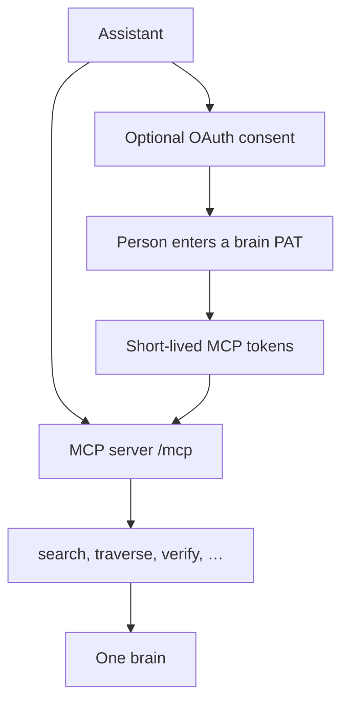

The **product MCP server** is a separate process (commonly port **8001**, path `/mcp`) that exposes BrainAPI as tools an assistant can call: search, traverse the graph, list brains, verify facts, inspect conflicts, and read source versions. **OAuth** (2.21.1) is an optional sign-in so a hosted assistant can connect without you pasting a raw PAT into a config file. This is not the [Docs MCP](/v2/agentic/docs-mcp), which only searches these documentation pages.

## Why it exists

Assistants cannot reliably keep REST details in a prompt. MCP gives them named tools with typed arguments. OAuth adds a consent page: a person types a brain access key once, and the assistant receives short-lived tokens bound to that brain.

Everyday example: a support lead connects their help-center brain to a desktop assistant. The assistant calls `search_semantically` for "return window" and `traverse_graph` from the Returns policy node. On a hosted connector, they open a BrainAPI consent page, paste a **brain** PAT, and continue. The system-wide operator token cannot be used to grant that OAuth connection.

## When to use it

**Use product MCP** when an assistant should choose tools across several turns. **Use a PAT in the MCP adapter** for local desktop clients that you configure yourself. **Use hosted OAuth** when the assistant app must sign in through a browser.

**Do not** point an assistant at Docs MCP and expect it to read your brain. **Do not** put the system PAT into OAuth consent; only a brain-scoped PAT can grant access. **Do not** expose every tool if the assistant only needs retrieve. **Do not** treat MCP as a replacement for your own backend when you already know the exact REST call.

## How it works

1. Start the MCP server next to the API (`make start-mcp`, or `brainapi start`).
2. Desktop clients that speak stdio typically use a small HTTP adapter pointed at `/mcp`, with a bearer PAT.
3. If `MCP_OAUTH_ISSUER_URL` (or `MCP_HOSTED_OAUTH_ISSUER_URL`) is set, the server advertises OAuth. The assistant redirects a person to `/mcp-oauth/consent`.
4. Consent stores OAuth parameters under a one-time `request_id`. The person submits a brain PAT. BrainAPI issues an authorization code and then access/refresh tokens. Stored PATs in Redis are encrypted (2.21.1).
5. Tool calls still require that the token may access the requested `brain_id`.

## Going deeper

### Tool catalog (product MCP)

**What.** Shipped tools include `get_search_operation_instructions`, `search_semantically`, `search_memory`, `traverse_graph`, `list_brains`, changelog and source-version readers, verification tools, and conflict tools. There is **no** MCP tool to start a conflict scan.

**Why.** Assistants need a small, documented set of verbs.

**When.** Start with `search_semantically` when you do not know ids, then `traverse_graph`. Use `search_memory` only for a read-only query the other tools do not cover. Raw graph writes stay off unless `GRAPH_RAW_WRITE_ENABLED=true`.

### Desktop adapter

**What.** Many desktop MCP clients launch a local stdio program. BrainAPI speaks HTTP, so you run a stdio-to-HTTP adapter with `URI` set to the `/mcp` URL and a bearer token.

**Why.** The client and the server do not have to share a transport.

**When.** Follow [Connect an MCP client](/v2/agentic/MCP) for the adapter setup. Never commit the token.

### Hosted OAuth (2.21.1)

**What.** Consent is a one-time `request_id`. After POST, BrainAPI redirects with HTTP **303**. Access tokens default to a one-hour TTL. Refresh-token TTL is unset (no expiry) unless `MCP_OAUTH_REFRESH_TOKEN_TTL` is set. Encryption uses `BRAINPAT_TOKEN` plus the issuer URL; changing either makes stored PATs undecryptable and clients must sign in again. Leftover plaintext PAT values are deleted on startup.

**Why.** Hosted assistants should not hold your long-lived PAT in their config.

**When.** Set issuer and resource URLs together. Keep `BRAINPAT_TOKEN` and the issuer stable across deploys. `MCP_OAUTH_CHATGPT_ONLY=true` or a set `MCP_HOSTED_OAUTH_ISSUER_URL` restricts client registration and authorize redirects to the hosted connector callback.

### Scopes on OAuth

**What.** Default OAuth scopes follow `MCP_OAUTH_SCOPES` (usually `brainapi`). `verification` can be requested only if the PAT already has it. OAuth cannot escalate.

**Why.** A consent form should not mint expert powers the PAT lacks.

**When.** Use a review-only PAT when the assistant should verify facts; otherwise leave verification off.

### Docs MCP versus product MCP

**What.** Docs MCP is `https://brainapi.lumen-labs.ai/docs/mcp` and only fetches documentation.

**Why.** Coding agents need the docs; they should not receive your tenant data as a side effect.

**When.** Configure both as separate servers. Never reuse a brain PAT on the docs endpoint expecting it to search a brain.

## Technical reference

- [Connect agents](/v2/agentic)
- [Product MCP](/v2/agentic/MCP)
- [Docs MCP](/v2/agentic/docs-mcp)
- [Fact verification](/v2/retrieval/verification)
- [Conflicts](/v2/retrieval/conflicts)
- [Configuration](/v2/configuration)
- [What's new](/v2/changelog)
