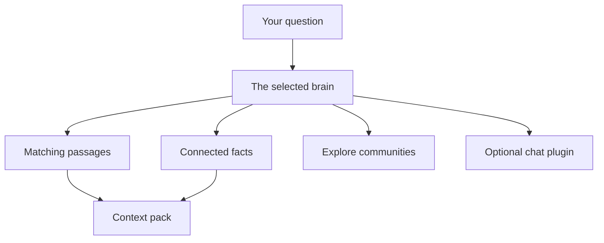

**Retrieval** is how you get knowledge back out of a brain. You can ask a question and receive a **context pack** (quoted passages plus graph facts), browse entities, walk neighbors, or open a bird's-eye **Explore** view of a large graph. An optional **chatbot** plugin can sit on top and talk to the same brain. These are different doors into one room, not competing products.

## Why it exists

Saving knowledge is useless if every caller has to reinvent "find the relevant notes." Retrieval is the shared way to ask. Different callers need different shapes: an assistant wants evidence to ground a reply, a dashboard wants a map, an investigator wants neighbors of one person.

Everyday example: a school operations lead types "Who is covering pickup this Friday?" Context retrieval returns the duty roster paragraph and the graph fact that Alex covers Friday pickup. In Explore, the same brain shows the "staffing" cluster so the lead can click from Alex to related shifts. A chat plugin, if installed, can wrap that in a conversation — still scoped to that school brain.

## When to use it

**Use context retrieval** when the next step is an assistant or any component that needs passages and facts together. **Use Explore** when a person is navigating a large PostgreSQL graph. **Use entity APIs** when you already know the name or id. **Use the chatbot plugin** only if you want a ready-made chat endpoint.

**Do not** call ranked Search on hosted production; `SEARCH_ENABLED` is off there and `/retrieve/search` returns **404**. **Do not** assume Explore works on every graph store (other drivers return **501**). **Do not** treat chat as core BrainAPI; it is an optional plugin. **Do not** expect retrieval to include an import that has not finished its [task](/v2/concepts/tasks).

## How it works

1. You send a question (or a node id) with a PAT and brain ID.
2. BrainAPI reads only that brain.
3. Context retrieval gathers a bounded set of passages and graph facts, with ids you can cite.
4. Explore (PostgreSQL graph) builds a snapshot of communities so you can drill in without loading every node.
5. Chat, if the plugin is installed, calls your configured inference settings and can use the brain as memory.

Rejected facts stay hidden unless you set `include_rejected=true`. See [Verified and rejected facts](/v2/concepts/verification).

## Going deeper

### Context packs

**What.** `POST /retrieve/context` with the question text. The response includes passages, graph triples, optional history, and provenance fields such as `source_chunk_ids` and `source_passages`.

**Why.** Assistants need evidence, not only a similarity score.

**When.** This is the default retrieve for Q&A. Tune `max_facts` and `max_passages`. For a date-specific question, pass `as_of` ([History](/v2/concepts/history)).

### Ranked Search (opt-in)

**What.** `GET`/`POST /retrieve/search` returns ordered hits with snippets. It requires PostgreSQL and `SEARCH_ENABLED=true`. Hosted production leaves it off.

**Why.** Some products are a search box and need a stable ranked list.

**When.** Enable it only on deployments that need that UI. Context retrieval is not the same endpoint and does not run Search plugins.

### Explore (PostgreSQL graph)

**What.** `GET /retrieve/explore/v1/overview` returns top-level communities and build status. Open a community with `GET /retrieve/explore/v1/communities/{id}` (include the snapshot id). Browse live neighbors with `GET /retrieve/explore/v1/neighbors/{entity_id}`. In 2.21.1, overview snapshots store a capped set of `overviewLinks` (4000) plus `overviewLinksTruncated`.

**Why.** A graph with tens of thousands of nodes cannot be drawn all at once. Communities are a table of contents.

**When.** Use it on `GRAPH_DB=networkx` (the PostgreSQL graph driver). Other backends return **501**. Refresh the overview on HTTP **409** (expired snapshot). Filters `types` and `connectionTypes` are comma-separated.

### Entity lookup and neighbors

**What.** `GET /retrieve/entity/status` checks whether a named entity exists and returns its node, relationships, and observations. Other graph routes list neighbors and hops.

**Why.** Sometimes you are not asking a sentence; you are inspecting one person or thing.

**When.** Use these when the application already knows the target. Synergies and recommendations are **preview** surfaces for related items; quality gates are not release-stable.

### Chat plugin (optional)

**What.** The vendored **chatbot** plugin adds `POST /chatbot/inference`. **chatbot-memory** can keep conversation threads inside one brain. Neither is a core route.

**Why.** Some teams want a turn-taking API without building one.

**When.** Install the plugin only if you need that endpoint. Core retrieve and MCP already cover "ask the brain." Do not confuse this with the product MCP server.

### Console graph view

**What.** The local Console at `/console/` (when enabled) shows graph, chunks, vectors, observations, tasks, and a quick text ingest.

**Why.** Operators need eyes on a brain without writing curl.

**When.** Use it for inspection. It is not a customer chat UI.

## Technical reference

- [Choose a retrieval surface](/v2/retrieval)
- [Context](/v2/retrieval/context)
- [Search](/v2/retrieval/search)
- [Recommendations](/v2/retrieval/recommendations)
- [Entity existence](/v2/retrieval/entities/existence)
- [Retrieve API](/v2/reference/api/retrieve)
- [Chatbot plugin](/v2/chatbot)
- [Console](/v2/console)
