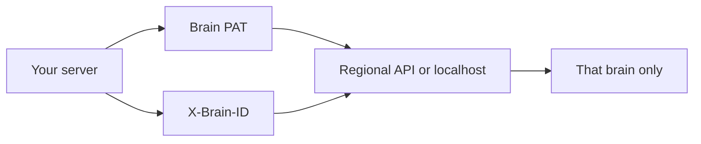

You talk to BrainAPI with a **personal access token (PAT)** and a **brain ID**. Official **Python** and **Node.js** client libraries wrap the same REST API but are **pre-1.0**. **Billing** on managed BrainAPI is a monthly plan plus a per-character overage. Self-hosted operators run their own stack under the BrainAPI license and do not use these plan prices.

## Why it exists

Every request needs a credential and a room. Client libraries save boilerplate. Managed plans exist so teams who do not want to operate Neo4j, workers, and MCP themselves can still use a regional host.

Everyday example: a startup stores a brain PAT in their server (never in the browser), sends `X-Brain-ID: acmehq`, and calls ingest and context over REST. While the Node library is still pre-1.0 they generate a client from OpenAPI or use curl. Their managed invoice is the Build plan plus characters ingested over the included amount.

## When to use it

**Use a brain PAT** in applications and assistants. **Use the system PAT** only in your operator tools. **Use REST** for production until the SDKs reach 1.0. **Use managed billing** when you are on BrainAPI Cloud. **Use self-host** when you run the engine yourself.

**Do not** put PATs in URLs, git, screenshots, or analytics. **Do not** call `api.brain-api.dev`; that hostname does not resolve. **Do not** treat SDK method names as the contract — the OpenAPI snapshot is. **Do not** assume hosted Search is included; it stays off in hosted production.

## How it works

1. Create or receive a brain. The engine issues a brain PAT at creation time.
2. Send `BrainPAT: …` (or `Authorization: Bearer …`) and `X-Brain-ID: …` on each call. Managed REST uses [regional hosts](/v2/reference/regional-hosts); a common US host is `https://system.us-east1.brainapi.lumen-labs.ai`.
3. Optionally wrap calls in `lumen_brain` (Python) or `@lumenlabs/lumen-brain` (Node). Both are pre-release.
4. On managed Cloud, usage is billed monthly by plan, with character overage at a published rate.

## Going deeper

### PAT shapes

**What.** System PAT: env `BRAINPAT_TOKEN`, all brains plus `/system/*`. Brain PAT: one stored brain. Either header form is accepted. Default scope is `brainapi`; add `verification` only for review writes.

**Why.** Least privilege is a brain-sized key.

**When.** See [Brains and isolation](/v2/concepts/brains). There is no `rotate-pat` route in this version.

### Python SDK

**What.** Package [`lumen_brain`](https://pypi.org/project/lumen_brain/) on PyPI. The published client is a `LumenBrainDriver` (or `AsyncLumenBrainDriver`) with methods such as `save_message` and `query_memory`.

**Why.** Scripts and backends often prefer a native client.

**When.** Fine for prototypes. For production, prefer REST or an OpenAPI-generated client until 1.0 ships. You can mix: ingest over REST, retrieve via MCP.

### Node.js SDK

**What.** Package [`@lumenlabs/lumen-brain`](https://www.npmjs.com/package/@lumenlabs/lumen-brain) on npm, also pre-1.0.

**Why.** Same as Python for TypeScript services.

**When.** Same guidance: useful, not the production contract.

### OpenAPI

**What.** [OpenAPI 3.1](https://brainapi.lumen-labs.ai/docs/openapi.json) lists operations with stable `operationId` values. The [API reference](/v2/reference) is generated from a checked-in snapshot.

**Why.** Generated clients and tool-calling adapters should follow the snapshot, not a blog post.

**When.** Regenerate when you bump engine versions. Plugin routes are not in the core snapshot.

### Managed plans

**What.** Published monthly prices:

| Plan | Price |
| --- | --- |
| Ask | $29 |
| Build | $99 |
| Team | $299 |
| Studio | $899 |

Character overage is $0.000003 per character. Request a managed BrainPAT from [BrainAPI support](mailto:hello@lumen-labs.ai). Customer rate limits may differ; your agreement is authoritative.

**Why.** Hosted teams need a simple menu.

**When.** Use these figures for managed Cloud only. Self-host licensing is separate (see the engine README). Health checks and `X-Request-ID` belong in support tickets.

### Self-host CLI

**What.** `npm install -g brainapi-tui` then `brainapi init` and `brainapi start` for a local stack.

**Why.** Developers should reach a working brain without assembling every service by hand.

**When.** Follow the [CLI guide](/v2/tui). Local `http://localhost:8000` is the API; MCP is commonly `:8001`.

## Technical reference

- [Developer portal](/v2/developers)
- [Authentication and brains](/v2/brains-and-auth)
- [API overview](/v2/reference)
- [Regional API hosts](/v2/reference/regional-hosts)
- [Errors and HTTP statuses](/v2/reference/errors)
- [BrainAPI CLI](/v2/tui)
