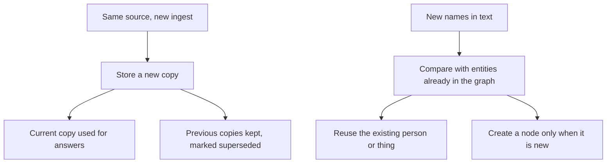

A **source** is an ingested document, note, or import, identified by a `source_key`. When you ingest that source again, BrainAPI can keep the **current copy** and **previous copies** instead of pretending the old wording never existed. **Dedupe** is the separate step that tries not to create a second graph node for the same real-world person or thing.

## Why it exists

Handbooks get republished. A CRM export runs every night. If each run wiped the last, you would lose [history](/v2/concepts/history). If each run added "Maya" as a brand-new person, the graph would rot.

Everyday example: the employee guide is ingested every Monday. Week 2 changes the remote-work paragraph. Retrieve prefers this week's copy for "What is the remote-work policy?" `list_source_versions` still shows last week's paragraph as a previous copy. The person "Alex Rivera" extracted from both weeks stays one entity, not two.

## When to use it

**Use source revisions** when the same document or app record will be sent more than once. **Use the Janitor / identity path** (accurate pipeline) when names in text should collapse to existing entities.

**Do not** confuse a new version of one source with a [conflict](/v2/concepts/conflicts) between two sources. **Do not** purge an import if you still need its previous copies. **Do not** expect dedupe to merge records that share no name, type, or identifier.

## How it works

1. Passages store metadata including `source_key`. Retrieve prefers the newest copy of an application source.
2. History-mode ingest keeps original revisions; older chunks carry `superseded_at`.
3. MCP `list_source_versions` (and the matching product tools) returns `current` and `previous` for a key, or discovers the key with a search query.
4. During extraction, the Janitor checks whether an entity or fact already exists so the accurate pipeline can reuse it.

Ranking cost for history is capped so old copies cannot dominate a result list.

## Going deeper

### Source keys

**What.** A stable id for "this document / this app record." Chunks for that key group into one source.

**Why.** Filenames change; a key should not.

**When.** Send a consistent key from your app when you re-import. If you only have a question, `list_source_versions` can take a `query` to find the key, then list copies. If embedding fails, that tool returns an error and no versions.

### Current versus previous copies

**What.** Current copies have no `superseded_at`. Previous copies do. The tool pages previous copies with `skip` / `limit` (cap 20).

**Why.** Answers should use today's wording unless the user asked about the past.

**When.** Use this for living documents. Use as-of queries when you care about valid-time on **facts**, not only document bytes.

### Dedupe during extraction

**What.** In the accurate pipeline, the Janitor looks for similar nodes and repeated facts before new relationships are accepted.

**Why.** "Emily" and a second "Emily" with the same role should not become two people without reason.

**When.** Stay on `PIPELINE_MODE=accurate` when identity quality matters. Lightweight mode skips heavier checks. You can still pass explicit ids in structured ingest so the app, not the extractor, owns identity.

### Purge one import

**What.** `POST /tasks/{task_id}/purge` removes graph data **owned by that import**. You send a digest from a preview, or a `source_key`. **404** means no recorded additions. **409** means the import changed or the purge is unsafe.

**Why.** Sometimes you ingested the wrong file and need that run gone, without deleting the whole brain.

**When.** Confirm before calling. This is not the same as keeping superseded copies for history.

## Technical reference

- [Product MCP](/v2/agentic/MCP) (`list_source_versions`)
- [Context history](/v2/retrieval/context#history-aware-retrieve)
- [Ingestion tasks](/v2/ingestion/tasks) (purge)
- [As-of retrieve](/v2/retrieval/as-of)
- [What's new](/v2/changelog)
