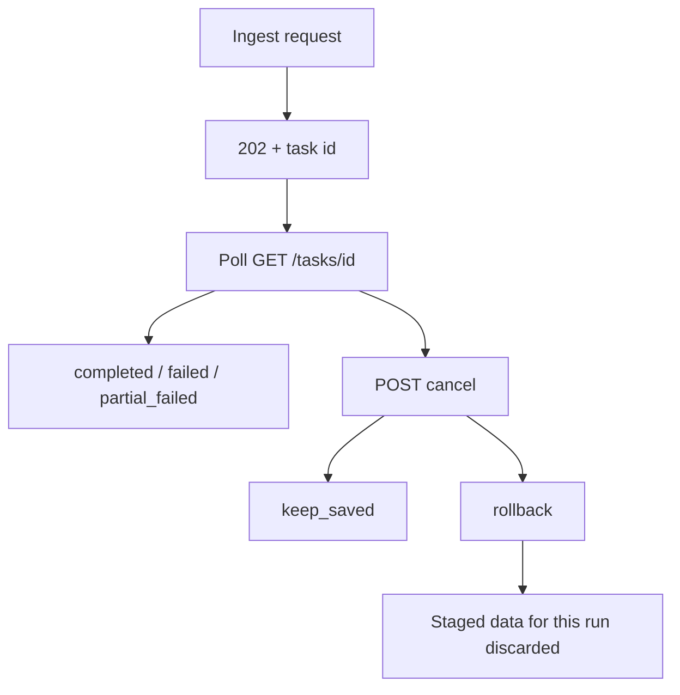

A **task** is the background job created when you ingest (and when you start some scans). You get a `task_id` with HTTP **202**. You poll that id in the same brain until the job finishes, fails, is cancelled, or cannot finish undoing. **Cancel** stops remaining work. **Rollback** (when staging is enabled) discards this run's staged data. **Purge** removes graph data owned by an import that already finished.

## Why it exists

Extracting a 200-page PDF is not instant. If the API blocked until it finished, your app would time out. If you had no way to stop a bad import, a mistaken upload would keep writing. Tasks are the job ticket: status, cancel, undo.

Everyday example: a librarian uploads a scanned yearbook. The UI shows "processing." After a minute they realize it is the wrong campus. They cancel with rollback (on a staged deployment) so partial pages never become "the" yearbook. Last year's successful import stays in the brain.

## When to use it

**Always poll** after ingest. **Cancel** when the operator picked the wrong file or the run is stuck in a way you choose to stop. **Rollback** when staging is on and you want this run's unpublished work discarded. **Purge** when a completed import should be removed.

**Do not** treat **404** as "still pending." **Do not** offer cancel or rollback in the UI unless the task lists `cancellation_modes`. That field is absent unless task control is on (`INGESTION_CANCELLATION_ENABLED=1` or `STAGED_INGESTION_ENABLED=1`). **Do not** assume staging is on; both staged flags default to off. **Do not** cancel with a different brain ID than you used to ingest.

## How it works

1. Ingest (text, file, URL, structured, or a conflict scan) returns `task_id`.
2. `GET /tasks/{task_id}` returns status and, when present, progress and `cancellation_modes`. Staged runs can be polled from durable state even if a cache entry is missing.
3. Terminal statuses include `completed`, `failed`, `partial_failed`, `cancelled`, and `rollback_failed`.
4. `POST /tasks/{task_id}/cancel` with `{ "mode": "keep_saved" }` or `{ "mode": "rollback" }` returns **202**. Repeat the same mode to read state. A different accepted mode, or a run past its publication cutoff, returns **409**.

Settlement and rollback each stop after 5 failures. Graph rollback distinguishes nodes this run created from ones it only reused, so undo does not delete a person that already existed.

## Going deeper

### Polling

**What.** Poll `GET /tasks/{task_id}` with the same PAT and brain. `GET /tasks/` lists known tasks for the brain.

**Why.** UIs and scripts need one place to wait.

**When.** Start polling after 202. Stop on 404 or a terminal status. Text ingest may honor a `Task-Identifier` header; file and structured ingest mint a new UUID.

### keep_saved versus rollback

**What.** `keep_saved` and `rollback` need task control: `INGESTION_CANCELLATION_ENABLED=1` or `STAGED_INGESTION_ENABLED=1`. Without either, the task has no `cancellation_modes`. `keep_saved` stops remaining work and keeps what already landed (and publishes completed staged units). `rollback` stops remaining work and discards this run's staged data. Earlier imports stay intact.

**Why.** Sometimes you want the pages that already processed. Sometimes you want the run to vanish.

**When.** Read `cancellation_modes` first. Rollback is listed only while the run is staged. Keep polling through `cancelling`. `rollback_failed` means cleanup retries were exhausted.

### Staged ingestion (opt-in)

**What.** `STAGED_INGESTION_ENABLED=1` stages text and URL requests that skip enrichment. `STAGED_ENRICHMENT_ENABLED=1` also stages enriched text/URLs, structured data, and files. Staged data stays private until publication. Other brain operations may briefly return **503** with `Retry-After` during publication; honor that header.

**Why.** Cancel-and-undo is unsafe if the run has already mixed into the live graph with no staging.

**When.** Enable on API and worker together, with a shared publication lock directory. Leave off for simple imports.

### Purge

**What.** `POST /tasks/{task_id}/purge` with a preview `digest` or `source_key` removes that import's owned graph data.

**Why.** A completed wrong file is not fixed by cancel.

**When.** Confirm. **409** means the import changed since preview, or purge is unsafe. This deletes owned graph data for that import; it is stronger than hiding a fact.

### Conflict scans as tasks

**What.** `POST /retrieve/conflicts/scan` also returns a `task_id`. Truncation and scan counts are on the task result.

**Why.** A full-brain scan is the same kind of background work as ingest.

**When.** Poll it like any other task. There is no MCP tool to start a scan.

## Technical reference

- [Ingestion tasks](/v2/ingestion/tasks)
- [Tasks API](/v2/reference/api/tasks)
- [Conflicts](/v2/retrieval/conflicts)
- [Configuration](/v2/configuration)
