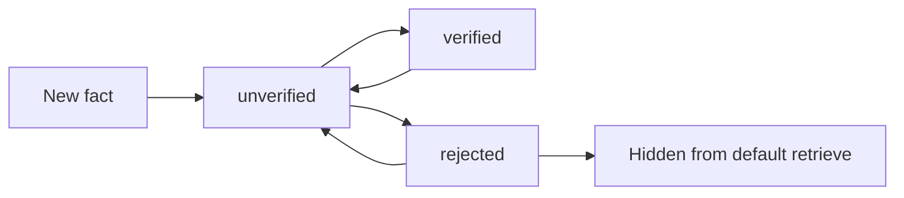

Every fact in a brain starts **unverified**. A person (or a trusted review service) can mark it **verified** or **rejected**. Ordinary retrieve, search, and graph walks hide rejected facts. Verified facts can receive a small ranking boost. The decision is stored with an append-only history; resetting to unverified does not erase that history.

## Why it exists

Extraction and imports are useful, but some facts must be blessed by a human: a medical protocol, a legal clause, a safety limit. Other facts are wrong and should not keep appearing in answers. Verification is that review switch, separate from "which source won a conflict."

Everyday example: a bot extracts "Visitors may use the roof terrace after dark." A facilities lead rejects it because the terrace closes at sunset. Until someone resets or re-imports a corrected sentence, assistants stop seeing the night-terrace claim. A second fact, "Fire exits stay unlocked during occupancy," is marked verified and is preferred in ranking.

## When to use it

**Use verification** when a person is accountable for what the brain may say. **Use reject** to hide a bad fact from default answers without deleting history. **Use reset** when a reject or verify was premature.

**Do not** grant the `verification` token scope to every client; it is **not** included by default. **Do not** treat unverified as "false" — it only means nobody has reviewed it. **Do not** rely on this as a substitute for keeping tenants in separate [brains](/v2/concepts/brains). Writes are the 2.21.0+ contract; older hosts return **404** on `/model/facts`.

## How it works

1. Ingested and modeled facts are unverified.
2. `POST /model/facts/{id}/verify` or `/reject` or `/reset` (and matching MCP tools) change the state. The actor is the authenticated token principal; a `verified_by` field in the body is ignored.
3. Default retrieve omits rejected facts unless `include_rejected=true`.
4. Listing facts hides rejected ones unless you ask for them (`include_rejected=true` or `state=rejected`).
5. Ranking may add `VERIFIED_FACT_RANK_BOOST` (default `0.15`; `0` disables it).

`fact_id` is a relationship UUID or an EVENT node UUID.

## Going deeper

### Token scope

**What.** Read APIs work with any valid PAT. Writes need scope `verification` on the system PAT (`BRAINPAT_SCOPES`) or the brain's stored `pat_scopes`. MCP OAuth can request `verification` only if the underlying PAT already has it. Scopes are cached for 30 seconds.

**Why.** Hiding or blessing facts is an expert action.

**When.** Grant the scope to review UIs and operators. Missing scope returns **403** `VERIFICATION_PERMISSION_DENIED`.

### REST and MCP

**What.** REST: `GET /model/facts`, `GET /model/facts/{id}`, and the verify/reject/reset POSTs. MCP: `list_facts_by_verification`, `get_fact_verification`, `verify_fact`, `reject_fact`, `reset_fact_verification`.

**Why.** Assistants and apps should use the same states.

**When.** Use REST from your backend. Use MCP when an assistant is the reviewer (still requires the scope).

### Interaction with conflicts

**What.** Verifying a fact also closes open conflicts for that fact (`verified_side` without rewriting states twice). Resolving a conflict with `method=verified_side` verifies the winner and rejects the loser, using the same scope.

**Why.** Reviewers should not click twice for the same decision.

**When.** Prefer this when the conflict really is "one side is right." If reject fails during `verified_side`, prior verification properties are restored and the conflict stays open.

### Include rejected

**What.** Retrieve, search, traverse, and MCP search hide rejected facts unless `include_rejected=true`.

**Why.** Default answers should not keep quoting a rejected claim. Auditors still need a way to see it.

**When.** Set the flag only on review screens. Leave it off for user-facing assistants.

## Technical reference

- [Fact verification](/v2/retrieval/verification)
- [Conflicts](/v2/retrieval/conflicts)
- [Authentication and brains](/v2/brains-and-auth)
- [Model API](/v2/reference/api/model)
- [Configuration](/v2/configuration)
